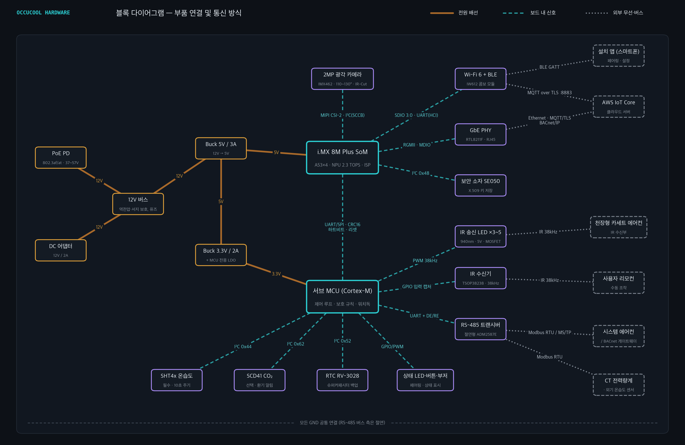
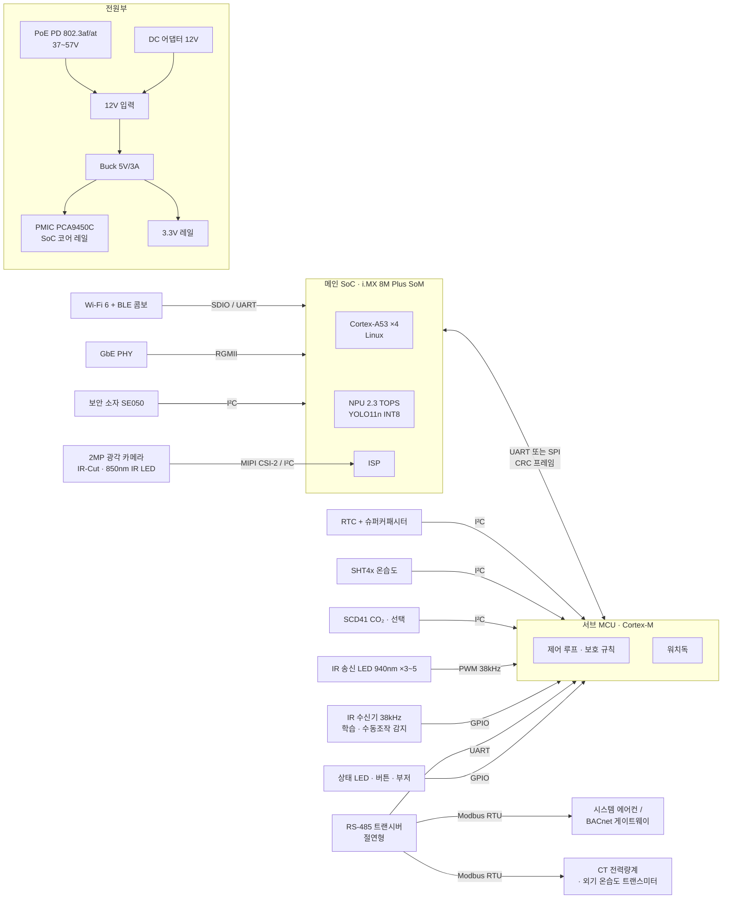

# OccuCool 하드웨어 구성 리포트

> 재실 인원 기반 냉난방 자동 제어 엣지 AI 컨트롤러에 필요한 하드웨어와 부품별 전압·전류·통신 방식 정리
>
> 작성일: 2026-10-14
> 참고 자료: `index.html`(Architecture 섹션), `PRD/PRD_AI.md`(4. 기술 스택), `report/check_list.md`(현장 조사 결과), `report/preprocess_report.md`, `report/postprocess_report.md`, `report/model_selection_report.md`, `report/VLM_report.md`

---

## 0. 요약

| 항목 | 결정 내용 | 근거 문서 |
|---|---|---|
| 구조 | **SoC(영상 추론) + MCU(실시간 제어) 2-프로세서 구조** | index.html Architecture: "영상 추론은 NPU가, 실시간 제어는 별도 MCU가 맡아 서로의 장애가 번지지 않게 나눴습니다" |
| 메인 SoC | NXP i.MX 8M Plus (Cortex-A53 ×4 + NPU 2.3 TOPS) | PRD_AI 4장, model_selection_report |
| 서브 MCU | Cortex-M 계열 (센서·IR 송신·RS-485·워치독 담당) | PRD_AI 4장 |
| 카메라 | 2MP MIPI-CSI 광각 110~130°, IR 겸용 | PRD_AI 4장 |
| 센서 | SHT4x 온습도(I²C), 선택: SCD4x CO₂, ToF/열화상 | PRD_AI 4장 |
| 에어컨 연동 | IR 38kHz / RS-485 Modbus RTU / BACnet 게이트웨이 | PRD_AI 4장, check_list 6-3 |
| 에너지 측정 | CT 센서 (에어컨 전용 회로) | check_list 8-1, preprocess_report E1 |
| 통신 | BLE 5.4(설치·페어링), Wi-Fi 또는 Ethernet(PoE) + MQTT over TLS | PRD_AI 4장 |
| 보안 | X.509 장치 인증서, 보안 부트, 서명 OTA | PRD_AI 4장 |
| 전원 | PoE 또는 DC 입력 (파일럿 현장은 상시 콘센트) | PRD_AI 3장, check_list 9-1 |
| 예상 소비전력 | 평상시 약 5W, 현실적 최대 약 12W, 최악 약 17W | 본 리포트 9장 계산 |

> **표기 원칙**: 아래 전압·전류 값은 해당 부품 계열의 **데이터시트 대표값**입니다. 실제 부품 번호를 확정한 뒤 반드시 최신 데이터시트로 다시 확인해야 합니다. 부품 번호는 "이 정도 사양의 부품"을 보여 주는 예시이며 확정 BOM이 아닙니다.

---

## 1. 시스템 블록 다이어그램



> 주황 실선 = 전원 배선, 청록 점선 = 보드 내 신호(통신 방식 표기), 회색 점선 = 외부 무선·버스 연결.
> 이미지 생성 스크립트: `report/images/make_hardware_diagram.py` (부품·연결을 수정한 뒤 `python3 report/images/make_hardware_diagram.py`로 다시 생성)



### 역할 분담 원칙

| 프로세서 | 담당 | 이유 |
|---|---|---|
| **SoC (i.MX 8M Plus)** | 카메라 입력, NPU 추론, 추적·재실 판정(V1~V9), 클라우드 통신(MQTT/TLS), 오프라인 로그 버퍼(N2), OTA | 리눅스와 NPU가 필요한 무거운 작업 |
| **MCU (Cortex-M)** | 온습도·CO₂ 측정(S1~S6), IR 송수신, RS-485 Modbus, 출력 보호(P1·G1: 압축기 3분 보호, 시간당 4회 제한), SoC 워치독 | SoC가 재부팅되거나 멈춰도 **에어컨 보호 규칙과 안전 모드가 계속 동작**해야 함 (PRD: 시스템 가동률 99.5%, 오프라인 24시간 로컬 제어) |

> 참고: i.MX 8M Plus는 내부에 Cortex-M7 코어가 있어 외부 MCU 없이도 구현할 수는 있습니다. 하지만 같은 칩·같은 전원을 공유하면 SoC 리셋 시 함께 영향을 받으므로, index.html의 "장애가 번지지 않게 분리" 원칙에 맞춰 **외부 MCU를 권장**합니다. 원가 절감 버전(v2)에서 내부 M7로 통합을 검토할 수 있습니다.

---

## 2. 메인 연산부 (SoC · 메모리 · 저장장치)

### 2-1. 메인 SoC — NXP i.MX 8M Plus (SoM 형태 권장)

| 항목 | 사양 |
|---|---|
| CPU | Cortex-A53 ×4 (최대 1.8GHz) + Cortex-M7 (800MHz) |
| NPU | 2.3 TOPS (VeriSilicon), TFLite NPU 델리게이트 / eIQ |
| ISP | 듀얼 ISP 내장 (HDR, 노출·화이트밸런스 고정 설정 가능 → 전처리 V1 "노출·WB 고정"에 활용) |
| 카메라 입력 | MIPI CSI-2 4-lane ×2 |
| 주요 인터페이스 | GbE ×2(1개 TSN), USB 3.0 ×2, PCIe Gen3 ×1, SDIO(Wi-Fi), UART ×4, I²C ×6, SPI ×3, CAN-FD ×2 |
| 보안 | HAB 보안 부트, CAAM 암호 가속기 → PRD "보안 부트·서명 OTA" 충족 |

| 전원 레일 (SoC 내부, PMIC가 생성) | 전압 | 비고 |
|---|---|---|
| VDD_ARM (CPU 코어) | 0.85~1.0V | DVFS로 동적 변경 |
| VDD_SOC / VDD_NPU | 0.85V (오버드라이브 0.95V) | NPU 사용 시 부하 증가 |
| LPDDR4 | 1.1V (VDDQ 0.6V는 LPDDR4X일 때) | |
| I/O 뱅크 | 1.8V 또는 3.3V | **뱅크별로 다름 → MCU(3.3V)와 연결 시 레벨 확인 필수** |
| 전용 PMIC | NXP PCA9450C (I²C로 SoC가 제어) | SoM에 포함되는 경우가 대부분 |

| SoM 단위 소비전력 (대표값) | 값 |
|---|---|
| 입력 전압 | SoM 제품에 따라 3.3V 또는 5V 단일 입력 |
| 대기 / 일반 부하 | 약 1.5W / 약 2.5~3W |
| 최대 (CPU 4코어 + NPU + ISP) | 약 5~6W |
| 5V 입력 기준 최대 전류 | 약 1.2A → **5V 레일은 2A 이상 여유 설계** |

> **발열 주의**: 천장 안쪽은 고온 환경이 될 수 있습니다(check_list 9-4). 24시간 NPU 추론 시 방열판과 케이스 통풍 설계가 필요하며, model_selection_report L3 검증에서 "24시간 연속 발열 확인"을 실기기로 해야 합니다.

### 2-2. 메모리 · 저장장치

| 부품 | 사양 | 전압 | 통신 | 용도 |
|---|---|---|---|---|
| LPDDR4 RAM | 2GB (권장) / 4GB | 1.1V | SoC DDR 컨트롤러 | 영상 프레임은 RAM에서만 처리하고 즉시 폐기 (V1) |
| eMMC | 16~32GB | 3.3V(VCC) / 1.8V(VCCQ) | eMMC 5.1 (8-bit) | OS, 모델(~3MB), 오프라인 로그 버퍼(24시간 수 MB) |

---

## 3. 서브 MCU (실시간 제어)

| 항목 | 사양 (예: STM32G0B1 / STM32L4 계열 Cortex-M0+/M4) |
|---|---|
| 동작 전압 | 1.7~3.6V (**3.3V 레일 사용**) |
| 동작 전류 | 약 100µA/MHz → 64MHz 동작 시 약 6~10mA, 슬립 시 수 µA |
| 필요 주변장치 | UART ×3 (SoC 연결, RS-485, 디버그), I²C ×1~2 (센서·RTC), 타이머 PWM (IR 38kHz 캐리어), 입력 캡처 (IR 수신 디코딩), ADC (선택: 전원 전압 감시), 독립 워치독(IWDG) |
| SoC ↔ MCU 통신 | **UART 115,200~921,600bps** 또는 SPI, 패킷마다 CRC16 + 시퀀스 번호 |
| SoC 감시 | SoC가 1초마다 하트비트 전송 → 일정 시간 끊기면 MCU가 SoC 리셋 핀(POR_B)을 당기고 **안전 모드** 진입 |

**MCU가 SoC 없이도 하는 일 (안전 모드)**
- 직전 설정 유지 또는 운영 스케줄 기반 운전 (PRD 예외 처리)
- 압축기 최소 재기동 3분, 설정 변경 5분 간격, 시간당 4회 이하 (P1·G1)
- 온습도 측정과 로그를 RTC 시각 기준으로 계속 기록

---

## 4. 카메라 모듈

| 항목 | 사양 |
|---|---|
| 해상도 | 2MP (1920×1080), 추론 입력은 320 또는 416px로 축소 (model_selection_report) |
| 이미지 센서 예 | Sony IMX462 (STARVIS, 근적외선 감도 높음 → 야간 IR 대응) |
| 화각(FOV) | 110~130° 광각 (PRD) |
| 프레임 | 5fps (공실 시 0.5fps로 낮추는 적응형 샘플링, preprocess_report) |
| IR-Cut 필터 | 주간 IR 차단 / 야간 IR 통과 자동 전환 (ICR) |

| 전원 레일 | 전압 | 전류 (대표값) |
|---|---|---|
| 아날로그 (AVDD) | 2.9V | 약 40~60mA |
| 디지털 코어 (DVDD) | 1.2V | 약 80~100mA |
| 인터페이스 (DOVDD) | 1.8V | 약 5~10mA |
| 모듈 단위 입력 | 3.3V 단일 입력 (모듈 내 LDO) | 약 100~150mA (약 0.3~0.5W) |
| IR-Cut 전환 코일 | 3.3~5V, 펄스 구동 (H-브리지) | 전환 순간 약 100~150mA, 수백 ms |

| 통신 | 방식 |
|---|---|
| 영상 데이터 | **MIPI CSI-2 (2-lane 또는 4-lane)** → SoC ISP |
| 센서 설정 | **I²C (SCCB)**, 400kHz |
| 동기·리셋 | GPIO (RESET, PWDN) |

### 4-1. 야간 IR 조명 (선택)

| 항목 | 사양 |
|---|---|
| 파장 | 850nm (약한 붉은빛이 보임) / 940nm (보이지 않지만 감도 낮음) |
| LED 순방향 전압 | 약 1.5~1.8V (LED당) |
| 구동 전류 | LED당 100~350mA, **정전류 드라이버**로 구동 |
| 소비전력 | 약 1~2W (야간에만 점등) |
| 제어 | MCU 또는 SoC GPIO/PWM → 조도 센서나 ISP 밝기 값 기준으로 ON/OFF |

> **파일럿 현장은 야간 재실 없음, 창 없음, LED 상시 점등**이라(check_list 2-1, 2-5) IR 조명은 v1 파일럿에서 생략하고 실장 패턴만 남겨 두는 것을 권장합니다.

> **⚠ 문서 간 불일치 – 확인 필요**
> - PRD는 광각 110~130°인데, 현장 체크리스트(3-2)는 일반 화각 ~90°로 체크되어 있습니다.
> - index.html 전처리 판단 1: 천장 2.4m·90° 렌즈를 중앙에 달면 머리 높이에서 보이는 폭이 약 1.4m 뿐이라 100~300㎡를 1대로 덮을 수 없습니다. **광각(110~130°) 이상 또는 사선 설치가 사실상 필수**이므로 하드웨어는 PRD 사양(광각)을 따르는 것이 맞습니다.

---

## 5. 센서

### 5-1. 온습도 센서 — Sensirion SHT4x (필수)

| 항목 | SHT40 | SHT45 |
|---|---|---|
| 정확도 | ±0.2°C, ±1.8%RH | ±0.1°C, ±1.0%RH |
| 공급 전압 | 1.08~3.6V (**3.3V 사용**) | 동일 |
| 측정 중 전류 | 약 320µA (고정밀 모드 측정 시간 약 8ms) | 동일 |
| 대기 전류 | 약 0.08µA | 동일 |
| 통신 | **I²C**, 최대 1MHz, 주소 **0x44** (변형품 0x45/0x46) | 동일 |
| 측정 주기 | 10초 (PRD, check_list 5-4) | |

**설치 주의 (preprocess_report S4, 오탐 Top 5 3번)**
- 천장형 카세트 토출 기류가 닿으면 실제보다 낮게 측정됩니다. **센서는 컨트롤러 본체가 아니라 내벽 1.2~1.5m 높이의 별도 소형 모듈**로 빼는 것을 권장합니다.
- 본체(SoC) 발열이 센서에 전달되지 않도록 같은 기판에 둘 경우 슬롯 절연과 거리를 확보합니다.
- 벽면 원격 모듈을 쓰면 I²C는 긴 케이블에 약하므로(1m 이내 권장), 아래 둘 중 하나를 선택합니다.
  - 체크리스트대로 **Wi-Fi 온습도 센서**(check_list 5-5) → MQTT/HTTP로 SoC에 전달
  - **RS-485 Modbus 온습도 트랜스미터** → 에어컨 연동용 RS-485 버스에 함께 연결 (유선이라 결측이 적음)

### 5-2. CO₂ 센서 — Sensirion SCD41 (선택)

| 항목 | 사양 |
|---|---|
| 측정 원리 | 광음향 NDIR, 400~5,000ppm |
| 공급 전압 | 2.4~5.5V |
| 평균 전류 | 약 15mA @3.3V (5초 주기 측정) / 저전력 모드 약 3mA |
| 피크 전류 | 약 205mA @3.3V (측정 순간) → **전원 레일에 벌크 커패시터 필요** |
| 통신 | **I²C**, 100kHz, 주소 **0x62** |
| 용도 | 인원 추정 보조가 아니라 **환기 품질 알림용**(PRD: CO₂는 인원 추정이 부정확) |

### 5-3. 프라이버시 민감 현장용 대체 센서 (선택)

카메라를 쓸 수 없는 현장용(index.html: "ToF·열화상 센서로 대체 가능").

| 센서 예 | 해상도 | 전압 | 전류 | 통신 | 특징 |
|---|---|---|---|---|---|
| Melexis MLX90640 (열화상) | 32×24 | 3.3V | 약 23mA | I²C (주소 0x33, 최대 1MHz) | 사람 열원 직접 검출, 소인원 계수 가능 |
| Panasonic Grid-EYE AMG8833 (열화상) | 8×8 | 3.3V | 약 4.5mA | I²C (0x68/0x69) | 저렴, 재실 여부 판정 수준 |
| ST VL53L5CX (ToF) | 8×8 거리 | AVDD 3.3V, IOVDD 1.8/3.3V | 측정 중 약 100mA 내외 | I²C (최대 1MHz) | 높이 정보로 사람/가구 구분 |

> 열화상·ToF는 해상도가 낮아 "±1명 95%" 목표를 넓은 공간에서 맞추기 어렵습니다. 소형 구역(회의실 등) 전용으로 제한해야 합니다.

### 5-4. 외기온도 센서 (선택)

체크리스트 7-1에서 "외부 센서 설치 가능"으로 체크되었습니다.

| 옵션 | 전압 | 전류 | 통신 | 비고 |
|---|---|---|---|---|
| DS18B20 방수형 프로브 | 3.0~5.5V | 측정 중 약 1~1.5mA | **1-Wire** | 수십 m 배선 가능, 온도만 측정, ±0.5°C |
| RS-485 온습도 트랜스미터 (복사 차폐 쉘드 포함) | 12~24V DC | 약 10~30mA | **RS-485 Modbus RTU** | 에어컨 RS-485 버스에 공용 연결 가능 |
| 기상청 API | – | – | HTTPS | 하드웨어 불필요, 1시간 해상도 (preprocess_report O1) |

---

## 6. 에어컨 제어 인터페이스

파일럿 현장: **천장형 카세트 1대, IR 리모컨(단방향)** (check_list 6-1, 6-3)

### 6-1. IR 송신부 (가정용·스플릿·카세트)

| 항목 | 사양 |
|---|---|
| IR LED 예 | Vishay TSAL6200 (940nm) |
| 순방향 전압 | 1.35V @100mA / 약 2.6V @1A (펄스) |
| 전류 | 연속 최대 100mA, **펄스 피크 200mA~1A** (펄스폭·듀티 조건 준수) |
| LED 수 | 3~5개 (천장 → 카세트 패널 수신부까지 넓은 방향성 확보) |
| 구동 회로 | 5V 레일 → 전류 제한 저항 → LED → N-MOSFET(로직 레벨 게이트, 예: AO3400) → GND, MCU 타이머 PWM으로 게이트 구동 |
| 변조 | **38kHz 캐리어, 듀티 1/3**, 제조사별 프로토콜(NEC, 삼성, LG 등) 코드 DB |
| 평균 소비 | 명령 1회당 수십~수백 ms만 동작 → 평균 무시 가능, **피크 대비 5V 레일에 100~470µF 벌크 커패시터** |

### 6-2. IR 수신부 (학습 + 수동 조작 감지)

| 항목 | 사양 |
|---|---|
| 부품 예 | Vishay TSOP38238 (38kHz 복조 수신기) |
| 공급 전압 | 2.5~5.5V (**3.3V 사용**) |
| 공급 전류 | 약 0.35mA |
| 출력 | 디지털 복조 신호 (Active-Low) → **MCU GPIO 입력 캡처** |
| 용도 | ① 처음 설치 시 리모컨 코드 학습 ② **사용자가 리모컨을 누른 것을 감지** → 수동 조작 2시간 우선 규칙과 A2 "수동 조작 감지·라벨링"의 근거 데이터 |

> **IR 단방향 문제**: IR은 에어컨의 현재 상태를 읽을 수 없습니다. 체크리스트에는 "IR 단방향"과 "상태 피드백 모두 가능"이 함께 체크되어 있어 서로 모순됩니다(preprocess_report 7장 지적). 이 하드웨어 구성에서는 피드백을 다음 두 가지로 보완합니다.
> 1. **IR 수신기**로 사용자의 리모컨 명령을 엿들어 상태 변경을 추적
> 2. **CT 전력 측정**(7장)으로 정지 / 송풍 / 압축기 가동 상태를 추정 (E1 운전 상태 분류, A2 명령-피드백 대조)

### 6-3. RS-485 Modbus RTU (상업용 시스템 에어컨)

| 항목 | 사양 |
|---|---|
| 트랜시버 예 (비절연) | MAX3485 / THVD1450 계열: **3.3V**, 대기 약 1mA, 송신 시(54Ω 부하) 약 50~60mA |
| 트랜시버 예 (절연형, 권장) | ADM2587E 계열: 3.3V 또는 5V 입력, 절연 전원 내장, 약 70~100mA |
| MCU 연결 | **UART (TX/RX) + DE/RE 방향 제어 GPIO** |
| 프로토콜 | Modbus RTU, 9,600 / 19,200bps, 8N1 또는 8E1 |
| 배선 | 2선(A/B) + GND, 연선 차폐 케이블, 버스 양 끝 **120Ω 종단 저항**, 바이어스 저항 |
| ESD/서지 | TVS 다이오드(예: SM712) 필수 — 건물 배선은 길어 서지 유입 위험 |

> 건물 설비 배선과 연결되므로 **절연형 트랜시버**를 권장합니다. 접지 전위차로 인한 통신 오류와 기판 손상을 막습니다.

### 6-4. BACnet 게이트웨이

| 항목 | 사양 |
|---|---|
| BACnet MS/TP | 물리층이 RS-485 → 위 6-3 트랜시버를 그대로 사용, 9,600~76,800bps |
| BACnet/IP | **Ethernet(UDP 47808)** → SoC의 GbE 포트 사용 |
| 제조사 게이트웨이 | 에어컨 제조사의 RS-485/BACnet 게이트웨이(별도 구매 품목)를 통해 실내기 그룹 제어 |

### 6-5. 제조사 Wi-Fi API (P1, v2)

- 하드웨어 추가 없음. SoC의 Wi-Fi/Ethernet으로 HTTPS 클라우드 API 호출
- 전원·설정온도·모드 **상태 피드백을 정확하게 읽을 수 있는** 가장 좋은 경로 (index.html 로드맵 v2)

---

## 7. 에너지 측정 (CT 센서)

체크리스트 8-1: "에어컨 전용 계량기/CT 센서 설치 가능"

| 옵션 | 구성 | 전압 / 전류 | 통신 | 장단점 |
|---|---|---|---|---|
| **A. 외장 Modbus 전력량계 (권장)** | DIN 레일 단상 전력량계 + 분할형 CT | 계측 대상 AC 220V 60Hz, 계량기 자체는 상용 전원으로 동작 | **RS-485 Modbus RTU** (에어컨 버스 공용) | 컨트롤러 안으로 220V가 들어오지 않아 **안전·인증이 쉽고**, 유효전력(W)·적산(Wh)을 바로 읽음 |
| B. CT + 계량 IC 내장 | SCT-013-000 (100A:50mA 전류 출력) 또는 SCT-013-030 (30A:1V 전압 출력) + 계량 IC (예: ATM90E26, 3.3V, SPI/UART) | CT 2차측 수십 mA / 계량 IC 3.3V 약 5mA | **SPI 또는 UART** → MCU | 원가는 낮지만 정확한 유효전력을 위해 전압 측정(220V 분압)이 필요 → 절연·안전 설계 부담 |
| C. CT 전류만 측정 (간이) | SCT-013-030 + MCU ADC (부담저항, 1.65V 바이어스) | ADC 입력 0~3.3V | **아날로그 → MCU ADC** | 전압을 가정하므로 피상전력 수준. 운전 상태 분류(정지/송풍/압축기)에는 충분 |

- 측정 데이터 사용처: E1(1분 평균, Wh 적산, 운전 상태 분류), A2(명령-피드백 교차 검증), E2(기준선 대비 절감률 15% 산출)
- 압축기 가동 판정 임계값: 정격 소비전력의 20% (preprocess_report 권장값)
- 천장형 카세트의 압축기는 **실외기**에 있으므로, CT는 실외기를 포함한 에어컨 전용 분기 회로에 설치해야 압축기 상태를 볼 수 있습니다.

> **안전**: CT 설치와 분전반 작업은 반드시 전기 기술자가 해야 합니다. 분할형 CT는 활선 상태에서 클램프할 수 있지만, 전압 측정선 연결은 차단 후 작업합니다.

---

## 8. 통신 · 보안 · 보조 부품

### 8-1. 무선 통신 — Wi-Fi + BLE 콤보 모듈

| 항목 | 사양 |
|---|---|
| 모듈 예 | NXP IW612 기반 모듈 (예: Murata Type 2EL) — Wi-Fi 6 (2.4/5GHz) + Bluetooth LE 5.x + 802.15.4 |
| 공급 전압 | 3.3V (VBAT) + 1.8V (VIO) |
| 전류 | 수신 약 60~100mA, **송신 피크 약 300~500mA** → 3.3V 레일 600mA 이상 여유 |
| SoC 연결 | Wi-Fi: **SDIO 3.0**, Bluetooth: **UART (HCI, 4선 흐름제어)** |
| 상위 프로토콜 | 서버: **MQTT over TLS (포트 8883)** → AWS IoT Core, 설치: **BLE GATT** (스마트폰 앱 페어링) |
| 인증 | 국내 판매 시 **KC 전파 인증**이 된 모듈 선택 (모듈 인증 활용 시 비용·기간 절감) |

> PRD는 BLE 5.4를 명시합니다. 모듈의 펌웨어가 BLE 5.4 기능을 지원하는지, 또는 5.3 인증인지 선정 단계에서 확인해야 합니다. 설치·페어링 용도는 BLE 5.0 이상이면 기능상 충분합니다.

### 8-2. 유선 통신 — Ethernet + PoE

| 부품 | 사양 | 전압 / 전류 | 통신 |
|---|---|---|---|
| GbE PHY (예: Realtek RTL8211F, Microchip KSZ9131) | 10/100/1000BASE-T | 3.3V + 내부 코어 레일, 약 100~150mA (0.3~0.5W) | **RGMII** (SoC ↔ PHY), MDIO (설정) |
| RJ45 + 마그네틱스 | PoE 센터탭 지원형 | – | – |
| PoE PD 컨트롤러/모듈 (예: TI TPS2373, Silvertel Ag99xx 계열) | IEEE 802.3af (PD 최대 12.95W) / 802.3at (PD 최대 25.5W) | 입력 37~57V DC → 출력 12V 또는 5V, 효율 약 85~90% | 링크 분류(Class) 하드웨어 협상 |

> 파일럿 현장은 **Wi-Fi 안정 + 상시 콘센트**(check_list 9-1, 9-2)이므로 v1 파일럿은 DC 어댑터 + Wi-Fi로 시작하고, PoE는 상업용 현장용 옵션으로 둡니다.

### 8-3. 보안 소자

| 항목 | 사양 |
|---|---|
| 부품 예 | NXP EdgeLock SE050 |
| 공급 전압 | 1.62~3.6V (3.3V 사용) |
| 전류 | 동작 시 수 mA, 대기 수 µA |
| 통신 | **I²C**, 주소 0x48, 최대 3.4MHz |
| 용도 | 장치별 **X.509 인증서 개인키**를 칩 밖으로 꺼낼 수 없게 저장 → AWS IoT Core 상호 TLS 인증 |

### 8-4. RTC (실시간 시계)

| 항목 | 사양 |
|---|---|
| 부품 예 | Micro Crystal RV-3028-C7 |
| 공급 전압 | 1.1~5.5V |
| 전류 | 약 45nA (백업 시) |
| 백업 전원 | 슈퍼커패시터 또는 코인 셀 (정전 시 수일~수주 시각 유지) |
| 통신 | **I²C**, 주소 0x52 |
| 용도 | NTP가 안 될 때(오프라인 24시간)도 로그 타임스탬프 유지 (check_list 9-3, preprocess_report "엣지 기기를 마스터 시계로") |

### 8-5. 사용자 인터페이스 · 기타

| 부품 | 전압 / 전류 | 연결 | 용도 |
|---|---|---|---|
| RGB 상태 LED | 3.3V, 색당 약 5~10mA | MCU GPIO/PWM | 정상 / 오프라인 / 안전 모드 / 페어링 상태 표시 |
| **카메라 동작 표시 LED** | 3.3V, 약 5mA | 하드웨어적으로 카메라 전원 레일에 연동 | 프라이버시 신뢰 확보 (영상 처리 중임을 항상 표시) |
| 페어링/리셋 버튼 | 3.3V 풀업 | MCU GPIO | BLE 페어링 진입, 공장 초기화 (길게 누름) |
| 부저 (선택) | 3.3~5V, 약 20~30mA | MCU GPIO/PWM | 현장 설치 시 확인음 |
| 외부 워치독 (선택, 예: TPS3431) | 1.8~6.5V, 수 µA | MCU GPIO | MCU 자체가 멈추는 경우까지 대비 |
| 디버그 포트 | 3.3V | UART, SWD | 개발·현장 진단 |

---

## 9. 전원 설계

### 9-1. 전원 트리

```
[입력 A] DC 어댑터 12V / 2A (24W)  ─┐
[입력 B] PoE 802.3af/at 37~57V ─ PD ─┴─ 12V 버스 (역전압·서지 보호, 퓨즈)
                                          │
                     ┌────────────────────┼────────────────────────┐
                     ▼                    ▼                        ▼
               Buck 12V→5V/3A      (RS-485 트랜스미터·        IR 조명 정전류 드라이버
                     │              외기 센서용 12V 출력)        (선택, 야간)
     ┌───────────────┼───────────────┐
     ▼               ▼               ▼
 SoM 5V 입력    Buck 5V→3.3V/2A    IR 송신 LED (5V)
 (PMIC PCA9450C  │
  → 0.85~1.8V    ├─ MCU, SHT4x, SCD41, RTC, SE050
  코어 레일)      ├─ Wi-Fi/BLE 모듈, GbE PHY
                 ├─ 카메라 모듈 (내부 LDO → 2.9/1.8/1.2V)
                 └─ RS-485 트랜시버, LED, 버튼
```

- **MCU 전원은 SoC와 분리된 레일**(별도 LDO)로 공급해, SoC 쪽 과전류나 리셋이 MCU 동작을 멈추지 않게 합니다.
- 전원 순서(Power sequencing)는 SoM 데이터시트 순서를 따르고, MCU는 가장 먼저 켜져 SoC 전원 활성(EN) 핀을 제어하게 할 수 있습니다.

### 9-2. 전력 예산 (Power Budget)

| 부품 | 전압 | 평상시 전류 | 평상시 전력 | 최대 전력 |
|---|---|---|---|---|
| i.MX 8M Plus SoM (5fps NPU 추론) | 5V | 약 0.6A | 약 3.0W | 약 6.0W |
| 카메라 모듈 | 3.3V | 약 0.12A | 약 0.4W | 약 0.5W |
| Wi-Fi/BLE 모듈 | 3.3V | 약 0.1A | 약 0.3W | 약 1.7W |
| GbE PHY (PoE 사용 시) | 3.3V | 약 0.12A | 약 0.4W | 약 0.5W |
| 서브 MCU | 3.3V | 약 0.01A | 0.03W | 0.05W |
| SHT4x + RTC + SE050 | 3.3V | < 0.01A | < 0.03W | 0.05W |
| SCD41 (선택) | 3.3V | 약 0.015A | 0.05W | 0.7W |
| RS-485 트랜시버 (절연형) | 3.3V | 약 0.03A | 0.1W | 0.35W |
| IR 송신 LED | 5V | 거의 0 | – | 약 2.5W (수백 ms 펄스) |
| IR 조명 (선택, 야간) | 12V | – | 0W (주간) | 약 2.0W |
| LED·부저·기타 | 3.3V | 약 0.02A | 0.07W | 0.2W |
| **소계** | | | **약 4.4W** | **약 14.5W (모든 최대 동시 발생 가정)** |
| 변환 손실 (효율 약 85%) | | | 약 0.8W | 약 2.5W |
| **합계** | | | **약 5W** | **약 12W (IR 조명·IR 송신 펄스 제외 현실적 최대) / 약 17W (최악)** |

**전원 선택 결론**
- **DC 어댑터 12V / 2A (24W)**: 최악 조건까지 여유 충분 → **파일럿 권장**
- **PoE 802.3af (12.95W)**: IR 조명을 빼면 평상시(5W)는 넉넉하고 현실적 최대(약 12W)도 들어가지만 여유가 1W 수준입니다. IR 송신 펄스가 겹치는 순간을 대비해 IR 송신은 NPU 피크와 겹치지 않게 스케줄링하고, **IR 조명을 쓰는 모델은 802.3at(25.5W)** 로 설계합니다
- 연간 전력량: 5W × 24h × 365일 ≈ **44kWh/대** (에어컨 절감량 대비 무시 가능 수준)

---

## 10. 통신 인터페이스 총괄표

| 연결 | 주체 ↔ 대상 | 물리 계층 | 속도 / 설정 | 전압 레벨 |
|---|---|---|---|---|
| 카메라 영상 | SoC ↔ 카메라 | MIPI CSI-2 (2/4-lane) | 수백 Mbps/lane | 차동 신호 (D-PHY) |
| 카메라 설정 | SoC ↔ 카메라 | I²C (SCCB) | 400kHz | 1.8V (레벨 변환 확인) |
| 프로세서 간 | SoC ↔ MCU | UART (또는 SPI) | 115,200~921,600bps, CRC16 | 3.3V (SoC I/O 뱅크 3.3V 설정 또는 레벨 시프터) |
| 센서 버스 | MCU ↔ SHT4x(0x44), SCD41(0x62), RTC(0x52) | I²C | 100~400kHz | 3.3V, 풀업 4.7kΩ |
| 보안 소자 | SoC ↔ SE050(0x48) | I²C | 400kHz~ | 3.3V |
| IR 송신 | MCU → IR LED | PWM (타이머) | 38kHz 캐리어, 듀티 1/3 | 3.3V 게이트 → 5V LED |
| IR 수신 | IR 수신기 → MCU | GPIO 입력 캡처 | 복조 펄스 | 3.3V |
| 에어컨/계량기 | MCU ↔ 시스템 에어컨·전력량계·외기 센서 | RS-485 (UART + DE/RE) | Modbus RTU 9,600/19,200bps | 차동 (A/B), 절연 |
| BACnet | SoC ↔ 게이트웨이 | Ethernet (BACnet/IP) 또는 RS-485 (MS/TP) | UDP 47808 / 9,600~76,800bps | – |
| 무선 LAN | SoC ↔ Wi-Fi | SDIO 3.0 | 최대 약 100MB/s | 1.8V |
| 블루투스 | SoC ↔ BT | UART (HCI, RTS/CTS) | 3Mbps | 1.8V |
| 유선 LAN | SoC ↔ PHY | RGMII + MDIO | 1Gbps | 1.8V/2.5V/3.3V (PHY 설정) |
| 서버 | 기기 ↔ AWS IoT Core | Wi-Fi / Ethernet | MQTT over TLS 1.2+, 포트 8883 | – |
| 설치 앱 | 기기 ↔ 스마트폰 | BLE 5.x GATT | – | – |
| 외기 온도 (선택) | MCU ↔ DS18B20 | 1-Wire | 15.4kbps | 3.3V, 풀업 4.7kΩ |
| CT 계량 IC (옵션 B) | MCU ↔ ATM90E26 | SPI 또는 UART | 수 MHz / 9,600bps | 3.3V |

> **I²C 주소 충돌 없음**: 0x44(SHT4x), 0x48(SE050, SoC 쪽 버스), 0x52(RTC), 0x62(SCD41), 0x33(MLX90640 선택 시). 열화상 옵션을 추가해도 충돌하지 않습니다.

---

## 11. 개발 단계(PoC)용 대체 구성

preprocess_report 5장은 파일럿 현장(카메라 1대, 최대 5명, 2fps) 기준으로 **Raspberry Pi 5 + Hailo-8L**이면 충분하다고 판단했습니다. 맞춤 기판 제작 전 PoC 단계에서는 아래 상용 보드 조합이 빠릅니다.

| 역할 | 부품 | 전압 / 전류 | 통신 |
|---|---|---|---|
| 메인 보드 | Raspberry Pi 5 (4GB) | **5V / 5A USB-C PD** (27W 공식 어댑터), 대기 약 3W, 부하 약 8~12W | – |
| AI 가속기 | Hailo-8L (13 TOPS, AI HAT+ / M.2) | Pi에서 공급, 약 1~2W | **PCIe Gen2/3 ×1** |
| 카메라 | Raspberry Pi Camera Module 3 Wide (120°, IMX708) 또는 IMX462 모듈 | 3.3V (보드 공급) | MIPI CSI-2 2-lane, I²C |
| 서브 MCU | Raspberry Pi Pico 2 (RP2350) 또는 STM32 Nucleo | 5V USB 또는 3.3V | UART ↔ Pi |
| 온습도 | SHT4x 브레이크아웃 (Qwiic/STEMMA QT) | 3.3V | I²C |
| IR 송수신 | IR LED + MOSFET + TSOP38238 | 5V / 3.3V | PWM / GPIO (Pico) |
| RS-485 | USB-RS485 변환기 또는 RS-485 HAT | 5V USB | USB CDC → Modbus RTU |
| 전력 측정 | Modbus 단상 전력량계 + 분할형 CT | 계량기 자체 AC 전원 | RS-485 Modbus RTU |

> **주의**: 모델은 최종 배포 장비(i.MX 8M Plus NPU)에서 다시 검증해야 합니다. YOLO11의 C2PSA 어텐션 블록이 i.MX 8M Plus NPU에서 지원되지 않으면 CPU로 넘어가 지연이 커질 수 있습니다(model_selection_report 실험 E0). Hailo에서 잘 돌아도 NPU 호환성은 별개입니다.

---

## 12. 하드웨어 BOM 요약 (파일럿 v1 기준)

| No | 부품 | 수량 | 필수 여부 | 파일럿 현장 적용 |
|---|---|---|---|---|
| 1 | i.MX 8M Plus SoM (LPDDR4 2GB, eMMC 16GB, PMIC 포함) | 1 | 필수 | ✅ |
| 2 | Cortex-M MCU (STM32G0/L4급) | 1 | 필수 | ✅ |
| 3 | 2MP 광각 카메라 모듈 (110~130°, IR-Cut) | 1 | 필수 | ✅ |
| 4 | 850nm IR 조명 + 정전류 드라이버 | 1식 | 선택 | ❌ (야간 재실 없음) |
| 5 | SHT4x 온습도 센서 (벽면 모듈 또는 Wi-Fi 센서) | 1 | 필수 | ✅ |
| 6 | SCD41 CO₂ 센서 | 1 | 선택 | ❌ |
| 7 | IR 송신 LED 940nm + MOSFET 드라이버 | 3~5 | 필수 (IR 현장) | ✅ (IR 리모컨 현장) |
| 8 | IR 수신기 TSOP38238 | 1 | 필수 (IR 현장) | ✅ |
| 9 | 절연형 RS-485 트랜시버 + TVS + 종단저항 | 1 | 필수 (상업용) | ✅ (전력량계 연결용) |
| 10 | Modbus 단상 전력량계 + 분할형 CT | 1 | 권장 | ✅ (8-1 CT 설치 가능) |
| 11 | 외기 온도 센서 (DS18B20 또는 RS-485 트랜스미터) | 1 | 선택 | ✅ (7-1 설치 가능) |
| 12 | Wi-Fi 6 + BLE 콤보 모듈 (KC 인증) | 1 | 필수 | ✅ |
| 13 | GbE PHY + RJ45 + PoE PD | 1 | 선택 | ❌ (콘센트 + Wi-Fi) |
| 14 | 보안 소자 SE050 | 1 | 필수 | ✅ |
| 15 | RTC + 슈퍼커패시터 | 1 | 필수 | ✅ |
| 16 | 12V/2A DC 어댑터 + 5V/3.3V Buck 컨버터 | 1식 | 필수 | ✅ |
| 17 | 상태 LED, 카메라 표시 LED, 버튼, 부저 | 1식 | 필수 | ✅ |
| 18 | 케이스(천장 매립형) + 방열판 | 1 | 필수 | ✅ |

---

## 13. 추가 확인이 필요한 항목

1. **카메라 화각 확정**: PRD(110~130°)와 체크리스트(~90°) 불일치. 커버리지 계산상 광각 또는 사선 설치가 필요하므로 현장에서 설치 위치(천장 중앙 vs 모서리)와 함께 확정해야 합니다.
2. **에어컨 상태 피드백 경로**: IR 단방향인데 "상태 피드백 모두 가능"으로 체크됨. 유선 리모컨 단자, 제조사 Wi-Fi 모듈, RS-485 단자 유무를 실내기 명판·설치 매뉴얼에서 확인해야 합니다. 없으면 본 리포트의 IR 수신 + CT 추정 구성을 씁니다.
3. **천장형 카세트 IR 수신부 위치**: 컨트롤러 설치 위치에서 카세트 패널 수신창까지 시야와 거리를 확인해 IR LED 개수와 방향을 정합니다.
4. **압축기 최소 ON/OFF 사양**: 체크리스트 6-6 "확인 안 됨". MCU 보호 규칙 기본값(3분)을 제조사 사양으로 확정해야 합니다.
5. **NPU 연산 호환성(E0)**: 부품 발주 전 i.MX 8M Plus 평가보드에서 YOLO11n / YOLOv8n INT8 실행 비율과 지연(목표 200ms 이하)을 먼저 측정합니다.
6. **모델 사양 문서 간 차이**: index.html Architecture 섹션은 "YOLOv8n급, 320×320, 5~10MB"이고, AI Model 섹션·model_selection_report는 "YOLO11n, 416px, 약 3MB"입니다. 메모리·저장장치 용량에는 영향이 없지만 문서를 하나로 맞춰야 합니다.
7. **천장 내부 온도**: 설치 위치가 천장 안쪽이면 SoC 방열 설계와 부품 동작 온도 등급(산업용 -20~85°C 등)을 다시 정해야 합니다.
8. **인증**: 국내 판매 시 KC 전파 인증(무선 모듈), KC 전자파 적합성(EMC), 전기 안전 인증이 필요합니다. 220V를 기기 안으로 들이지 않는 구성(외장 전력량계, 외장 어댑터)이 인증 부담을 줄입니다.
