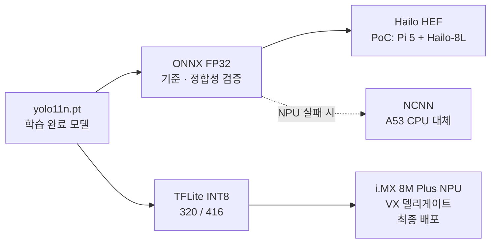

# OccuCool 추론 엔진 선정 리포트

> YOLO26n 추론 엔진 벤치마크(ONNX Runtime / OpenVINO / NCNN / TFLite) 결과와 `index.html`에 정리된 제품 요구사항을 함께 보고, OccuCool에 어떤 엔진을 써야 하는지 정리
>
> 작성일: 2026-10-15
> 참고 자료: `../ONNX_export/benchmark_engines.png`(기본 스레드), `../ONNX_export/benchmark_engines_4threads.png`(4스레드), `../ONNX_export/benchmark_engines.py`, `index.html`(How it works · AI Model · Architecture · Hardware 섹션), `report/model_selection_report.md`, `report/hardware_report.md`

---

## 0. 결론 요약

| 용도 | 추천 엔진 | 한 줄 근거 |
|---|---|---|
| **최종 배포 (i.MX 8M Plus NPU)** | **TFLite (LiteRT) INT8 + NPU 델리게이트** | 네 엔진 중 i.MX 8M Plus NPU를 공식 지원하는 경로가 사실상 TFLite뿐이고, index.html의 배포 사양(`~3 MB TFLite INT8`, 목표 200ms 이하)과도 일치합니다. 4스레드 CPU 성능도 1위와 거의 같습니다. |
| **기준 모델 · 정합성 검증 · PoC** | **ONNX Runtime (FP32)** | 다른 엔진의 출력을 비교하는 기준이자, Raspberry Pi 5 + Hailo-8L PoC에서 쓰는 Hailo 컴파일러의 입력 포맷입니다. |
| **CPU 대체 경로 (NPU 미지원 연산 발생 시)** | **NCNN** (후보) | Apple M4 CPU에서 가장 빠르고 지연 편차도 가장 작았습니다. 다만 FP16 출력 차이가 있어 카운트 지표로 다시 확인해야 합니다. |
| **제외** | **OpenVINO** | 가장 느리고(ORT 대비 0.70~0.73배), 인텔 하드웨어용이라 ARM 기반 제품에서 얻을 이점이 없습니다. |

> **주의**: 이번 벤치마크는 **Apple M4 CPU**에서 잰 값입니다. 실제 제품은 **Cortex-A53 ×4 + NPU 2.3 TOPS**라 절대 지연은 크게 다르고, 엔진 간 순위도 바뀔 수 있습니다. 이 리포트의 결론은 "M4 결과 + 대상 하드웨어 지원 여부"로 내린 1차 판단이며, 실험 E0(i.MX 8M Plus 실기기)에서 확정해야 합니다.

---

## 1. 벤치마크 결과 정리

### 1-1. 측정 조건

| 항목 | 값 |
|---|---|
| 모델 | YOLO26n (Ultralytics export, 입력 `[1,3,640,640]`) |
| 장비 | Apple M4 (CPU만 사용, GPU/NPU 미사용) |
| 이미지 | `bus.jpg` 1장 |
| 반복 | 워밍업 30회, 측정 300회, 네 엔진을 번갈아 실행(라운드로빈) |
| 공통 처리 | 전처리·후처리는 `onnx_infer.py`를 공유 → 차이는 추론 구간에서만 발생 |

### 1-2. 기본 스레드 설정 (`benchmark_engines.png`)

| 엔진 | 런타임 / 정밀도 | 모델(MB) | 추론 p50 | 추론 p95 | 추론 mean±std | E2E p50 | FPS(E2E) | ORT 대비 | 검출 수 | ORT 대비 max\|Δ\| |
|---|---|---|---|---|---|---|---|---|---|---|
| ONNX Runtime | onnxruntime 1.31.0 · CPU EP · FP32 | 9.9 | 37.94 | 47.81 | 39.22±8.07 | 45.32 | 22.1 | 1.00× | 5 | 0 |
| OpenVINO | openvino 2026.4.1 · CPU · FP16 | 9.7 | 52.26 | 64.11 | 53.76±9.65 | 60.29 | 16.6 | 0.73× | 5 | 39.5 px |
| **NCNN** | ncnn · CPU · auto FP16 | 9.7 | **37.02** | **45.59** | 38.41±5.36 | **44.15** | **22.6** | **1.02×** | 5 | 32.3 px |
| TFLite (LiteRT) | ai-edge-litert · XNNPACK · FP32 | 10.0 | 60.54 | 68.46 | 61.80±6.61 | 67.86 | 14.7 | 0.63× | 5 | 0.0031 px |

### 1-3. 4스레드 고정 (`benchmark_engines_4threads.png`)

i.MX 8M Plus의 CPU가 **Cortex-A53 4코어**이므로, 스레드를 4개로 맞춘 결과가 실제 제품 조건에 더 가깝습니다.

| 엔진 | 추론 p50 | 추론 p95 | 추론 mean±std | E2E p50 | FPS(E2E) | ORT 대비 |
|---|---|---|---|---|---|---|
| ONNX Runtime | 37.71 | 50.27 | 39.43±6.88 | 44.91 | 22.3 | 1.00× |
| OpenVINO | 54.24 | 61.22 | 55.45±5.24 | 62.09 | 16.1 | 0.70× |
| **NCNN** | **35.77** | **43.23** | **36.94±3.31** | **42.75** | **23.4** | **1.05×** |
| TFLite (LiteRT) | 36.77 | 44.29 | 37.68±3.35 | 43.71 | 22.9 | 1.03× |

### 1-4. 결과에서 읽을 수 있는 것

1. **NCNN · ONNX Runtime · TFLite는 4스레드에서 사실상 동률입니다.** 추론 p50 차이가 2ms(약 5%) 이내로, 이 정도는 장비·이미지가 바뀌면 쉽게 뒤집히는 범위입니다.
2. **TFLite가 기본 설정에서 느렸던 것은 스레드 설정 때문입니다.** 기본 60.54ms → 4스레드 36.77ms로 **약 39% 빨라졌습니다.** 엔진 자체가 느린 것이 아니라, LiteRT 파이썬 인터프리터의 기본 스레드 수가 적어서 생긴 차이로 보입니다. 배포 코드에서는 `num_threads`를 반드시 명시해야 합니다.
3. **OpenVINO는 두 조건 모두 가장 느립니다.** OpenVINO는 인텔 CPU/GPU/NPU에 최적화된 엔진이라 ARM에서는 장점이 없습니다.
4. **지연 안정성은 NCNN과 TFLite가 좋습니다.** 4스레드 표준편차가 3.3ms 수준으로 ONNX Runtime(6.9ms)의 절반이고, p95도 더 낮습니다. 제어 루프가 "감지 후 5초 이내"를 지켜야 하므로, 평균보다 꼬리 지연(p95)이 낮은 쪽이 유리합니다.
5. **정밀도 차이가 출력에 그대로 드러납니다.**
   - TFLite(FP32)는 ORT와 출력 차이가 0.003px로 **사실상 동일**합니다.
   - NCNN·OpenVINO는 내부적으로 FP16으로 계산해 원시 출력 차이가 최대 32~40px까지 납니다. 이 값은 8,400개 후보 박스 전체에서의 **최댓값**이라 최종 검출 결과(5개)는 같았지만, 사람이 작게 찍히는 사선 설치·원거리 영역에서는 경계 사례가 바뀔 수 있습니다.
6. **모든 엔진이 M4에서 5fps 요구사항을 크게 넘습니다**(14.7~23.4 FPS). 하지만 이는 M4 기준이며, Cortex-A53 CPU만으로는 수 배 느려질 수 있어 **CPU 추론 성능만으로 제품 엔진을 고를 수는 없습니다.** 결정적인 기준은 다음 장의 NPU 지원 여부입니다.

---

## 2. 제품 요구사항 (index.html 기준)

| 요구사항 | index.html 내용 | 엔진 선택에 미치는 영향 |
|---|---|---|
| 배포 하드웨어 | i.MX 8M Plus (Cortex-A53 ×4 + NPU 2.3 TOPS), LPDDR4 2GB | **NPU를 쓸 수 있는 엔진**이어야 함 |
| 배포 포맷 | `~3 MB TFLite INT8`, 입력 320 / 416 | INT8 양자화 지원 필수. 현재 FP32 모델(약 10MB)은 그대로 배포 불가 |
| 추론 지연 | 추론 ≤ 200ms, 5fps 유지 | NPU 오프로딩이 사실상 필요 |
| 런타임 | Architecture: `TFLite / ONNX Runtime + NPU` | 이미 두 엔진이 후보로 명시됨 |
| 모델 | YOLO11n 채택(NPU 비호환 시 YOLOv8n), YOLO26n은 비교 대상 | C2PSA 등 일부 연산이 NPU 미지원 시 CPU로 넘어가는 문제 → 실험 E0 |
| PoC | Raspberry Pi 5 + Hailo-8L(13 TOPS) | Hailo 컴파일러 입력은 ONNX → ONNX 포맷이 필요 |
| 전력 | 평상시 약 5W | CPU 풀가동보다 NPU 오프로딩이 전력에 유리 |
| 프라이버시 | 영상은 메모리에서 처리 후 즉시 폐기 | 엔진 무관 (모든 엔진이 온디바이스 처리) |

---

## 3. 엔진별 평가

| 평가 항목 | ONNX Runtime | OpenVINO | NCNN | TFLite (LiteRT) |
|---|---|---|---|---|
| M4 CPU 속도 (4스레드) | ◎ 37.7ms | △ 54.2ms | ◎ 35.8ms (1위) | ◎ 36.8ms |
| 지연 안정성 (std / p95) | ○ 6.9 / 50.3 | ○ 5.2 / 61.2 | ◎ 3.3 / 43.2 | ◎ 3.4 / 44.3 |
| ORT 대비 출력 일치도 | 기준 | △ FP16, 39.5px | △ FP16, 32.3px | ◎ 0.003px |
| **i.MX 8M Plus NPU 지원** | △ NXP eIQ에 포함되나 NPU 가속은 제한적·버전 의존 | ✕ 인텔 전용 가속, ARM은 CPU만 | ✕ NPU 미지원 (CPU/Vulkan GPU만) | ◎ **NXP eIQ 공식 경로 (VX 델리게이트)** |
| INT8 양자화 배포 | ○ QDQ 양자화 가능 | ○ NNCF | ○ 자체 INT8 | ◎ Ultralytics `int8=True` 한 줄, NPU용 전정수 모델 |
| index.html 사양 일치 | ○ 후보로 명시 | ✕ 언급 없음 | ✕ 언급 없음 | ◎ 배포 포맷으로 명시 |
| Hailo-8L PoC 연계 | ◎ ONNX가 컴파일러 입력 | ✕ | ✕ | ✕ |
| **종합** | **기준·PoC용** | **제외** | **CPU 대체 후보** | **최종 배포 1순위** |

> ◎ 매우 좋음 · ○ 좋음 · △ 보통/조건부 · ✕ 해당 없음/불리
> NPU 지원 여부는 공개 자료 기준이며, 사용하는 BSP·eIQ 버전에 따라 다를 수 있어 실기기에서 확인해야 합니다.

### 3-1. TFLite (LiteRT) — 최종 배포 1순위

- **장점**
  - i.MX 8M Plus NPU(VeriSilicon)를 쓰는 표준 경로가 TFLite + VX 델리게이트이며, model_selection_report의 실험 E0·E8도 이 경로를 전제로 합니다.
  - 4스레드 CPU에서도 1위(NCNN)와 1ms 차이로, NPU에서 일부 연산이 CPU로 넘어가도 CPU 구간 성능이 나쁘지 않습니다.
  - FP32 출력이 ORT와 사실상 같아 "PC에서 검증한 결과 = 기기 결과"를 확인하기 쉽습니다. INT8 변환 후 차이만 따로 보면 됩니다.
- **주의점**
  - `num_threads`를 명시하지 않으면 기본 설정에서 약 40% 느려집니다(1-4절 2번).
  - Ultralytics TFLite 출력은 박스 좌표가 0~1로 정규화되어 나옵니다. 벤치마크 코드처럼 입력 크기를 곱하는 후처리가 필요합니다.
  - 현재 모델은 FP32 10MB입니다. 목표 사양(~3MB)을 맞추려면 **INT8 전정수 양자화**가 필수이고, 정확도 하락 기준(mAP50 −2%p 이내)을 함께 확인해야 합니다.

### 3-2. ONNX Runtime — 기준 모델 · PoC

- 모든 엔진 비교의 기준(ORT 대비 Δ)으로 이미 쓰고 있고, `parity_check.py`처럼 PyTorch와의 정합성 검증에도 적합합니다.
- PoC 하드웨어인 Hailo-8L은 ONNX를 받아 HEF로 컴파일하므로, **ONNX export는 계속 유지**해야 합니다.
- 다만 i.MX 8M Plus NPU 가속은 TFLite보다 제약이 많아 최종 배포 엔진으로는 2순위입니다. index.html Architecture의 "TFLite / ONNX Runtime + NPU"는 E0 결과를 보고 **TFLite 하나로 좁히는 것**을 권장합니다.
- 4스레드 기준 p95(50.3ms)와 표준편차(6.9ms)가 NCNN·TFLite보다 커서, CPU 추론 시 꼬리 지연이 상대적으로 깁니다.

### 3-3. NCNN — CPU 대체 경로 후보

- M4 CPU에서 두 조건 모두 가장 빠르고 지연이 가장 안정적입니다. ARM 모바일 CPU용으로 만들어진 엔진이라 Cortex-A53에서도 강점이 있을 가능성이 큽니다.
- 그러나 i.MX 8M Plus NPU를 쓸 수 없으므로 **NPU 경로가 실패했을 때의 CPU 대체안**으로만 의미가 있습니다. (예: E0에서 YOLO11 C2PSA 블록이 NPU에서 돌지 않고, YOLOv8n으로 바꿔도 목표 지연을 못 맞추는 경우)
- 기본 FP16 연산 때문에 ORT와 최대 32px 차이가 납니다. 채택하려면 박스 단위 비교가 아니라 **Count MAE, ±1명 정확도**로 FP32와 동등한지 확인해야 합니다.

### 3-4. OpenVINO — 제외

- 두 조건 모두 최하위 수준의 속도(ORT 대비 0.70~0.73배)이고, FP16 출력 차이도 가장 큽니다(39.5px).
- 강점인 인텔 CPU·iGPU·NPU 가속을 OccuCool 하드웨어(NXP ARM)에서는 쓸 수 없습니다.
- 향후 인텔 기반 게이트웨이·미니 PC에서 여러 카메라를 모아 처리하는 구조로 바뀌지 않는 한 검토할 이유가 없습니다.

---

## 4. 권장 배포 경로

| 단계 | 엔진 | 할 일 |
|---|---|---|
| 개발·검증 | ONNX Runtime | PyTorch ↔ ONNX 정합성 확인, 다른 엔진 출력의 기준값 |
| PoC | ONNX → Hailo | Raspberry Pi 5 + Hailo-8L에서 파이프라인 전체 검증 |
| 최종 배포 | TFLite INT8 + NPU 델리게이트 | i.MX 8M Plus에서 200ms 이하·5fps 확인 |
| 대체 경로 | NCNN (CPU) | NPU 미지원 연산이 많아 목표 지연을 못 맞출 때만 |

---

## 5. 이번 벤치마크의 한계와 추가 실험

| 한계 | 영향 | 추가로 할 일 |
|---|---|---|
| **측정 장비가 Apple M4** | Cortex-A53과 성능 차이가 커서 절대값은 참고용 | Raspberry Pi 5(Cortex-A76) 또는 i.MX 8M Plus EVK에서 같은 스크립트로 4스레드 재측정 |
| **NPU 미측정** | 최종 엔진 선택의 결정적 근거가 빠져 있음 | 실험 E0: TFLite INT8 + VX 델리게이트로 NPU 실행 비율·지연 측정 |
| **모델이 YOLO26n** | index.html의 채택 모델은 YOLO11n(대안 YOLOv8n) | YOLO11n / YOLOv8n으로 같은 비교 반복 |
| **FP32 모델, 640px 입력** | 배포 사양은 INT8, 320/416px | INT8·320/416 조건으로 재측정 (`benchmark_resolution.py` 활용) |
| **정밀도 조건이 엔진마다 다름** | ORT·TFLite는 FP32, NCNN·OpenVINO는 FP16이라 완전한 동일 조건이 아님 | NCNN·OpenVINO를 FP32로 고정한 결과도 비교, 또는 모두 INT8로 통일 |
| **이미지 1장 (`bus.jpg`)** | 천장 시점·착석·저조도 등 실제 장면이 반영되지 않음 | 천장 시점 test셋으로 엔진별 Count MAE, ±1명 정확도 비교 |
| **max\|Δ\|만 비교** | 후보 박스 전체의 최댓값이라 실제 영향 판단이 어려움 | 신뢰도 0.15 이상 박스만 비교, 최종 인원수 일치율 측정 |

---

## 6. 최종 판단

1. **최종 배포 엔진은 TFLite (LiteRT) INT8 + i.MX 8M Plus NPU 델리게이트**로 합니다. CPU 성능은 1위와 사실상 같고, 대상 NPU를 공식 지원하는 유일한 경로이며, index.html의 배포 사양과도 일치합니다.
2. **ONNX Runtime은 기준 모델과 Hailo PoC용으로 유지**합니다. ONNX export는 검증·PoC 양쪽에서 계속 필요합니다.
3. **NCNN은 CPU 대체 경로 후보로 남겨 둡니다.** E0에서 NPU 경로가 목표를 못 맞출 때만 Cortex-A53 실측과 카운트 지표 검증을 거쳐 채택합니다.
4. **OpenVINO는 제외**합니다.
5. index.html Architecture의 런타임 표기(`TFLite / ONNX Runtime + NPU`)는 E0 결과가 나오면 `TFLite INT8 + NPU 델리게이트`로 확정해 고치는 것을 권장합니다.
